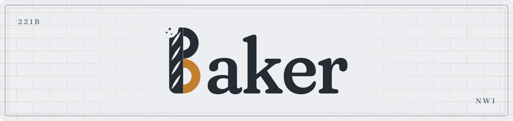

<picture>
  <source media="(prefers-color-scheme: dark)" srcset="others/assests/banner/baker_banner_dark.svg">
  
</picture>

# Baker

**A keen eye. A fresh result.**

Baker is a macOS menu-bar app for local capture, text and formula recognition, and PDF conversion.

**[Download Baker for Mac (.dmg)](https://github.com/PentagonToy/Baker/releases/download/v0.0.8/Baker-0.0.8-arm64.dmg)**

Apple Silicon · macOS 26.0 or later · Version 0.0.8

[Website and guide](https://pentagontoy.github.io/Baker/) · [Getting started](docs/help/getting-started.md) · [Changelog](CHANGELOG.md)

See the [0.0.8 release notes](others/release/0.0.8.md) for changes and validation limits.

| Task | Result |
| --- | --- |
| Capture | Display, area, window and scrolling images |
| Edit | Annotations, masking, background removal and SVG tracing |
| Text | Editable text with up to five of thirteen language choices |
| Formula | Preview, LaTeX, Markdown maths, Keynote or Unicode |
| PDF | Structured Markdown or LaTeX with equations, tables and figures |
| Record | MP4 with optional system audio, or silent GIF |

## In action

**Your equation, ready to paste.** Switch between LaTeX, Markdown and Unicode.

<a href="others/assests/videos/formula-formats.mp4"></a>

**PDF to Markdown or LaTeX.** Convert headings, body text and equations locally.

<a href="others/assests/videos/pdf-to-markdown.mp4"></a>

**Remove the background.** Keep the equation, with Undo and Redo.

<a href="others/assests/videos/remove-background.mp4"></a>

**Turn a capture into SVG.** Trace a diagram and return to the image with Undo.

<a href="others/assests/videos/vectorise-svg.mp4"></a>

Silent demos, under 10 seconds each. Select a preview for the MP4. [Demo sources and timing](others/assests/videos/README.md).

## Start

1. Download and open the DMG.
2. Drag **Baker.app** to **Applications**, then open it there.
3. Allow Screen Recording when prompted. Choose **Text** or **Formula**, select an area and paste the result.

If macOS blocks the first launch, see [opening a downloaded app](docs/help/troubleshooting.md#opening-a-downloaded-app). Set shortcuts and your save folder in Settings.

Already use Homebrew? Install from [our tap](https://github.com/PentagonToy/homebrew-tap):

```sh
brew install --cask pentagontoy/tap/baker
```

This developer-maintained tap is separate from Homebrew’s official cask collection. Use `brew upgrade --cask baker` for later releases.


Captures, recordings and formula history use one folder, initially `~/Documents/Baker`. A Finder-accessible synced folder also works with iCloud Drive, Dropbox or Google Drive. See [storage](docs/help/storage.md).

## Local recognition

Text uses Apple Vision or Tesseract; formula images use Pix2Text MFR 1.5 or the experimental Texo engine. PDFs combine native text, DocLayout-YOLO and quantised GLM-OCR with a small Baker adapter. [Models and references](docs/help/recognition.md) documents sources, adaptations and measured limits.

Text recognition and previews work offline with the included runtime. Download a [formula model](docs/models/README.md) once in Settings → Formula; subsequent recognition stays offline. PDF conversion downloads and verifies [PDF Engine 1.0.0](https://github.com/PentagonToy/Baker/releases/tag/pdf-engine-v1.0.0) once, then works offline. Normal use needs no OCR account, Python path or model configuration.

## Requirements

**Apple Silicon and macOS 26.0 or later**; PDF conversion requires **macOS 26.2 or later**. The interface is English. Scrolling is manual. Review recognised symbols and complex layouts against the source; see [limits](docs/help/limits.md).

[Build from source](docs/help/development.md) · [Release preparation](others/release/README.md) · [Privacy](docs/legal/privacy.md)

## Licence

Copyright © 2026 PentagonToy. Baker’s source uses [GNU AGPL version 3](LICENSE) (`AGPL-3.0-only`). Fonts, models and other dependencies retain their own [licences and notices](docs/legal/third-party.md).

## Agent CLI

Optional [OCR plugins](docs/help/plugins.md) can add a user-selected provider through one ZIP, with an optional Keychain-stored API key and local fallback. Built-in recognition remains local.

Baker includes a [JSON CLI](docs/help/cli.md) for local capture, recording, OCR, history and PDF conversion.
